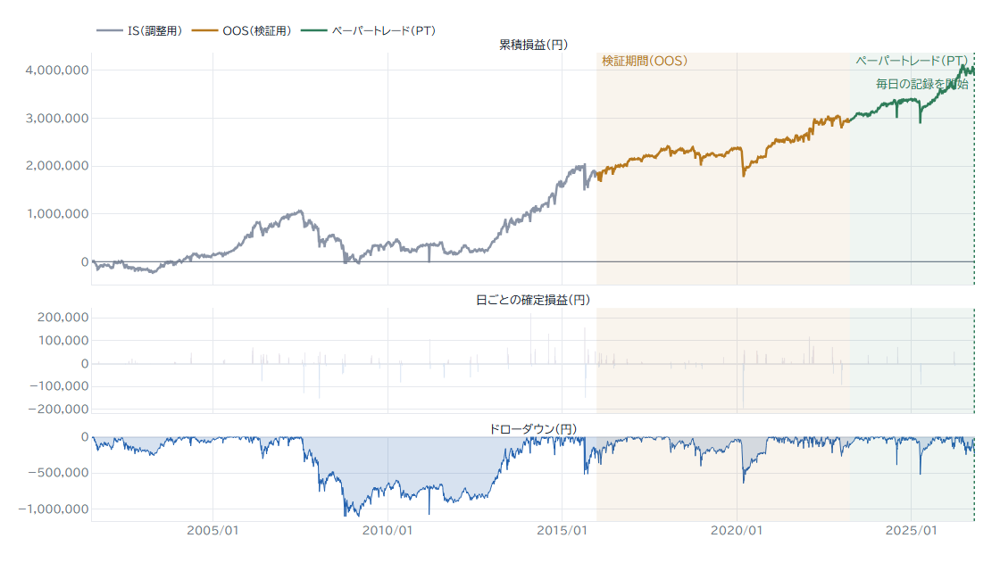

# quant-research-platform

日本株（東証の貸借銘柄 約 2,100）の売買ルールを過去のデータで検証し、選んだルールをペーパートレードで前向きに確かめるための環境です。
**実際の注文を出す機能はありません。**

- 日足・5 分足のバックテスト（呼値・ストップ高安・100 株単位・売買の費用を考えて約定させる）
- 資金に上限がある口座のシミュレーション（同時に持てる銘柄数＝枠、実際の 100 株で買えるかの判定）
- 日経平均の局面モデル（下げ相場にいる確率を毎日出すロジスティック回帰）
- ペーパートレード（毎日の大引けの後に、約定 → 時価評価 → 翌日の注文を 1 日ずつ進める）
- 結果の SQLite への保存と、確認画面（Streamlit）



## 検証の組み立て

過去のデータに合わせすぎたルールを選ばないことを、いちばん大事にしています。

| 期間 | 範囲 | 使い方 |
|---|---|---|
| IS（調整用） | 2001-07〜2015-12 | ルールとパラメータを選ぶ |
| OOS（検証用） | 2016-01〜2023-03 | 選んだルールを確かめる（選ぶのには使わない） |
| PT（ペーパートレード） | 2023-04〜 | ルールを選ぶのに使わない取り置きの期間。ペーパートレードのコードで 1 日ずつ動かして記録する |

- **先の値を使わない**: 合図は前日の大引けまでの値で作り、翌日の寄りの成行で約定させます。日経平均の寄りの値段は、指数の始値ではなく ETF の寄りから求めます（指数の始値は寄っていない銘柄を前日の終値で数えるため、急落の日ほど実際に売買できる値段からずれます。`trading.data.index_open`）。
- **約定の扱い**: ストップ高・ストップ安で引けた日は売買できないとし、個別株は実際の 100 株単位（後の株式分割の比率で当時の値段に戻して判定）で買います。
- **費用**: 気配の差 1 円（1 呼値が 1 円より大きい銘柄は 1 呼値）の半分を売り買いのたびに不利に約定、手数料 0 円、信用で借りる分の金利 年 2.8%、日経平均 ETF の売り買い 片道 0.05%。
- **選んだ後の偏りを測り直す**: 口座で買えなかった候補や使わなかった合図も含めた全部の候補で、合図そのものに中身があるかを t 値で測り直します（`study_bb2_signal_t.py`・`study_index_signal_t.py`）。日経平均で選んだルールは、S&P 500 と DAX でも確かめます（`study_index_exit_reentry_cross.py`）。
- **ペーパートレードとバックテストの突き合わせ**: ペーパートレードのコードを過去の日から動かし、バックテストと同じ取引になるかを確かめます（2023-04 から、#85 は 20 件、#87 は 23 件がすべて一致）。

## 今のところの結果

検証した手法のうち残ったのは、次の 2 つを 1 つの口座（100 万円・4 枠）にまとめた形です。番号は DB に保存した実行の番号です。

- **−2σ 割れの翌朝買い**: 市場全体が急に売られた日に、5 日ぶりに終値で 25 日の −2σ を割った貸借銘柄を、IS で選んだ 4 つの条件で絞り、翌日の寄りで買う。−1σ に戻った日の大引けか 10 営業日目に売る
- **日経平均の買い増し**: 前日の下げ相場の確率が 0.5 を超え、日経平均の終値が −2.5σ（#85）または −2σ（#87）より下の日に、翌日の寄りで資産の 75% 分の日経平均を買い増す

待機中の資金は、75% を日経平均（ETF）、25% を現金で持ちます。

| 期間 | 口座 | 資産の倍率 | 年率 | 最大の下げ | シャープ | 日経平均との差の t 値 |
|---|---|---|---|---|---|---|
| IS 2001-07〜2015 | #85（−2.5σ） | ×2.86 | +7.5% | −53.8% | 0.42 | 1.44 |
| | #87（−2σ） | ×2.32 | +6.0% | −66.0% | 0.36 | 1.06 |
| | 日経平均を持つだけ | ×1.60 | +3.3% | −61.4% | 0.26 | — |
| OOS 2016〜2023-03 | #85 | ×2.10 | +10.8% | −41.6% | 0.58 | 1.26 |
| | #87 | ×2.34 | +12.4% | −40.6% | 0.62 | 1.74 |
| | 日経平均を持つだけ | ×1.52 | +6.0% | −31.8% | 0.39 | — |
| PT 2023-04〜2026-10-28 | #85 PT | ×1.97 | +20.8% | −36.3% | 0.80 | −1.21 |
| | #87 PT | ×2.07 | +22.5% | −36.1% | 0.85 | −0.85 |
| | 日経平均を持つだけ | ×2.28 | +25.9% | −26.3% | 1.07 | — |

- IS・OOS では日経平均を持っているだけの場合を上回りましたが、月ごとの差の t 値はどれも 2 より小さく、偶然と区別できる差ではありません。
- 2023 年 4 月以降のペーパートレードでは、2 つとも日経平均を持っているだけの場合に負けています。
- ほかに、日足の空売り、5 分足のデイトレード、機械学習で買う順を決める形、暴落の予兆の指標（VIX・逆イールド・騰落レシオなど 14 個）、移動平均・MACD などで下げを避ける形も検証しましたが、OOS で偶然と区別できるほど成績が良いものはありませんでした。
- データは今も上場している銘柄だけで、上場廃止の銘柄は入っていません。古い期間ほど成績が良く出ている可能性があります。

## 構成

```
src/trading/
  data/       日足・5 分足の CSV の読み込み、yfinance / J-Quants、JPX の貸借銘柄・株式分割、日経平均の寄りの値段
  strategy/   ルール（日足の ±kσ の逆張り、5 分足の寄りの窓についていく形）
  backtest/   約定のエンジン（日足・5 分足・指値）、費用、ストップ高安、枠のある口座、評価指標
  regime.py   日経平均の局面モデル（下げ相場の確率）
  paper.py    ペーパートレード（1 日ずつの約定・時価評価・翌日の注文）
  store/      結果の SQLite への保存と、実行の名前付け
app/          確認画面（Streamlit。dashboard.py と charts.py）
scripts/      バックテスト・口座のシミュレーション・ペーパートレード・研究のスクリプト
config/       ルールの設定ファイル
tests/        テスト（pytest）
data/trading.db  見本の実行（#85・#87 の IS・OOS・PT）
```

`scripts/` の中心は次のとおりです。研究のスクリプトは一部だけを載せているので、コメントの中で載せていないスクリプトに触れているところがあります。

| スクリプト | 内容 |
|---|---|
| `run_backtest.py` | 設定ファイルの日足のルールを、全銘柄でバックテストする |
| `run_intraday.py`・`sweep_intraday.py`・`walkforward_intraday.py` | 5 分足のデイトレード（IS / OOS、パラメータの総当たり、ウォークフォワード） |
| `simulate_portfolio.py` | 多銘柄のルールを、枠のある 1 つの資金で運用する |
| `simulate_small_account.py` | −2σ 割れの翌朝買いと日経平均の買い増しを 1 つの口座で運用する（#85・#87） |
| `paper_trade.py` | ペーパートレード。毎営業日の 16:30 以降に 1 回動かす |
| `study_holdout.py` | 2023 年 4 月以降を取り置きにして、ルールを IS だけで選び直す |
| `study_regime_daily.py` | 局面モデルを学習する |

## 動かし方

Python 3.11 以上。

```powershell
python -m venv .venv
.venv\Scripts\Activate.ps1
pip install -r requirements.txt
pip install -e .
pytest
streamlit run app/dashboard.py   # 見本の DB（data/trading.db）の #85・#87 を確認できる
```

価格データはこのリポジトリに入っていません（取得元の規約で再配布できないため）。バックテストを動かすには、銘柄ごとの日足の CSV を
`data/daily/{code}_daily.csv`（5 分足は `data/5min/{code}_5min.csv`）に置きます。列は `datetime,symbol,open,high,low,close,volume` です。
日経平均と ETF の日足は yfinance から取ります。J-Quants を使う場合は `.env.example` を `.env` にコピーして API キーを入れます。

```powershell
python scripts/run_backtest.py --config config/daily_bb3_long_down.yaml
python scripts/simulate_small_account.py --capital 1000000 --slots 4 --index-weight 0.75 --n225-entry next_open --index-k 2.5 --oos-end 2023-03-31
python scripts/paper_trade.py --init --run 85 --start-date 2023-03-31   # #85 PT を始める
python scripts/paper_trade.py                                          # 毎営業日の大引けの後に進める
```

どれも価格データが要ります。`simulate_small_account.py` は、組み合わせる 2 つの手法の実行（`--close-run`・`--index-run`）が DB にあり、
`study_bb2_close.py` の結果（`results/bb2c_*.pkl`）と局面モデルの結果（`data/cache/regime_daily.csv`）ができている前提です。
確認画面の取引のチャートも、価格データがないときは表示されません。

## 作り方について

コードの多くは、Claude Code（Anthropic の AI）と対話しながら書きました。どの手法を採用するかや、2023 年 4 月以降を取り置きの期間にすることなどは、結果を見ながら自分で判断しています。
